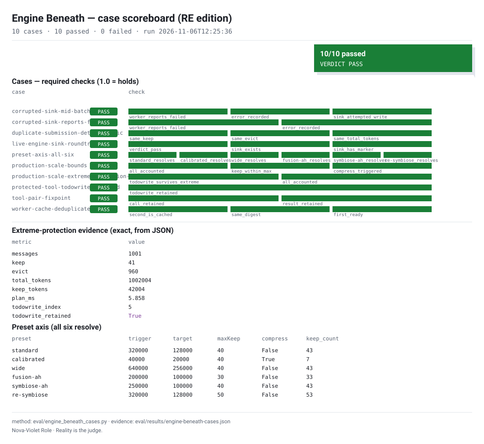
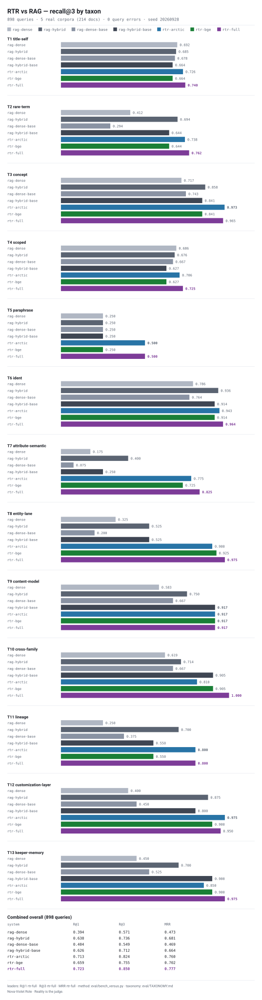
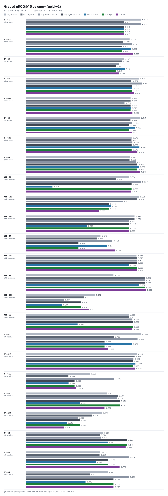

<!-- SPDX-FileCopyrightText: Nova-Violet Role ORG -->
<!-- SPDX-License-Identifier: EUPL-1.2 OR AGPL-3.0-or-later -->
# rtr-re-opencode-plugin

RTR-RE:Symbiose OpenCode plugins — the **Keeper** (server) and the
**ctrl+p palette** (TUI). Technical companion to the RTR-RE product.

Version 1.2.2.

## What ships here

| File | Role |
|---|---|
| `rtr-re-keeper.js` | Keeper server plugin: eviction planning, DTD-shaped memory sink, recency-aware todowrite protection, `/rtr` prompt commands, status file |
| `rtr-re-tui.tsx` | TUI plugin: fourteen ctrl+p palette commands (`status`, `enable`, `disable`, `preset`, `cpu`, `modality`, `threads`, `parking`, `trigger`, `target`, `max`, `evict-tokens`, `evict-messages`, `repair`) |
| `assets/rtr_presets.json` | Shared preset registry (keeper presets + CPU profiles + modalities) |

## Install

```bash
npm install rtr-re-opencode-plugin
# or, from the repo:
npm pack && npm install ./rtr-re-opencode-plugin-1.2.2.tgz
```

Add the plugin to your OpenCode config (`opencode.jsonc`):

```jsonc
{
  "plugin": ["./node_modules/rtr-re-opencode-plugin/rtr-re-keeper.js"]
}
```

The TUI plugin registers under the `palette` namespace (ctrl+p).

## Keeper behavior (measured contract)

- **Eviction** keeps the newest tail up to `maxKeepMessages` and
  `targetTokens`; everything evicted is written verbatim as DTD-shaped
  spans to `<project>/.opencode/memory/` and is retrievable via
  `memory_search`.
- **Protection**: `todowrite` tool messages are never evicted below 1000
  cumulative messages; past that, only recent protected messages stay
  hard-protected (recency window = `maxKeepMessages`).
- **Config** is read from `<project>/.opencode/rtr-re-keeper.json`
  (watched, no restart). The registry is reloadable
  (`OPENCODE_MEMORY_RTRRE_REGISTRY_FILE` override).
- **Status** is written atomically to
  `<project>/.opencode/rtr-re-keeper-status.json`.

## Live control

- Plain chat: `/rtr status|hold|trigger|target|max|preset|enable|disable`
- ctrl+p palette: `rtr.*` commands write the same watched config file.

## 🧪 Evaluation

Keeper behavior is frozen by gate (`mjs/scripts/keeper-behavior.mjs`: 8
scenarios, version-pinned manifest) and proven by the Engine Beneath
battery (27/27). Install via npm, measure via pypi, source on git —
every number re-runs.

| Taxon | What it isolates |
|---|---|
| T13 keeper-memory | evicted-span retrievability (rtr-full 0.975) |



<details>
<summary>Full versus + graded plates</summary>





</details>

## The installer session

The plugin package also ships the RTR-RE terminal installer (no browser,
no network). Launch it from the terminal:

```bash
npx --package rtr-re-opencode-plugin rtr-re-installer --theme network
```

The session is the same on every platform with a different personality:
**The Network** (magenta/violet, node-graph progress) for npm, **The
Instrument** (cool cyan, oscilloscope) for pip/uvx, **The Forge** (raw
build-log) for GitHub. Three presets (Quick MUGEN, Custom, Hardcore with
Recommended-from-Saimonokuma badges), adaptive arcade remixes of
*Obsession*, and the MiDi-MoE-Symbiogen-000 easter egg.

## Tests

```bash
bun test rtr-re-keeper.test.mjs
bun test rtr-re-tui.test.ts
```

## License

AGPL-3.0-or-later OR EUPL-1.2.
